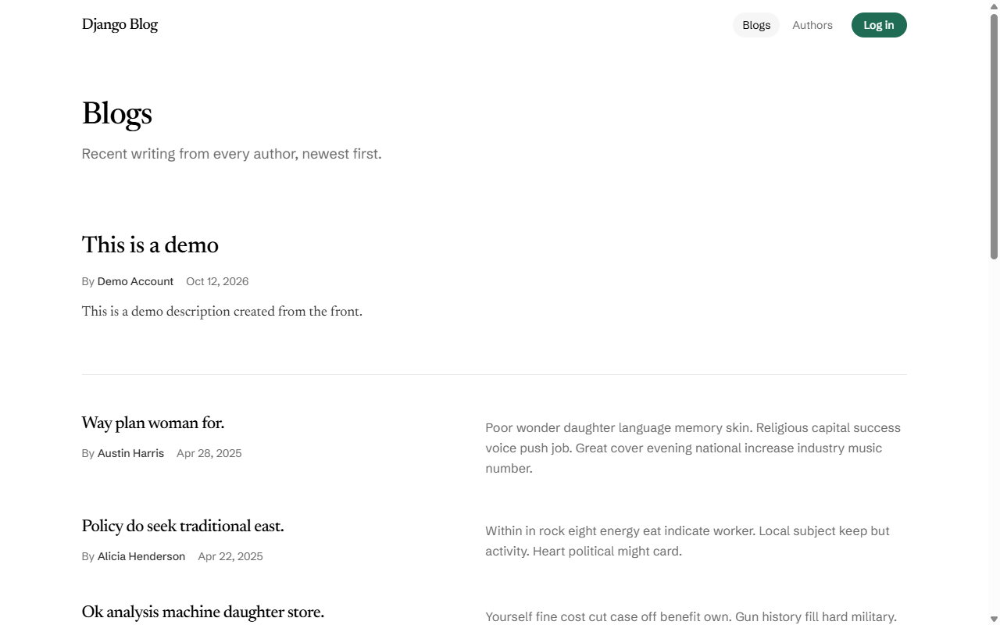
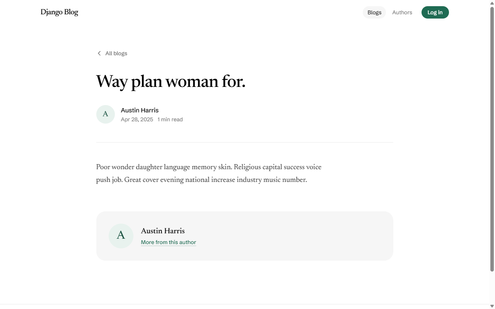
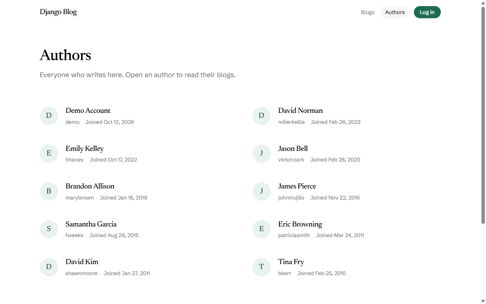
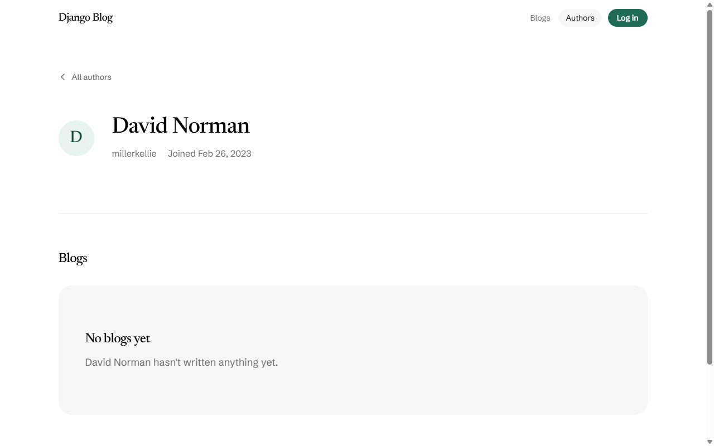
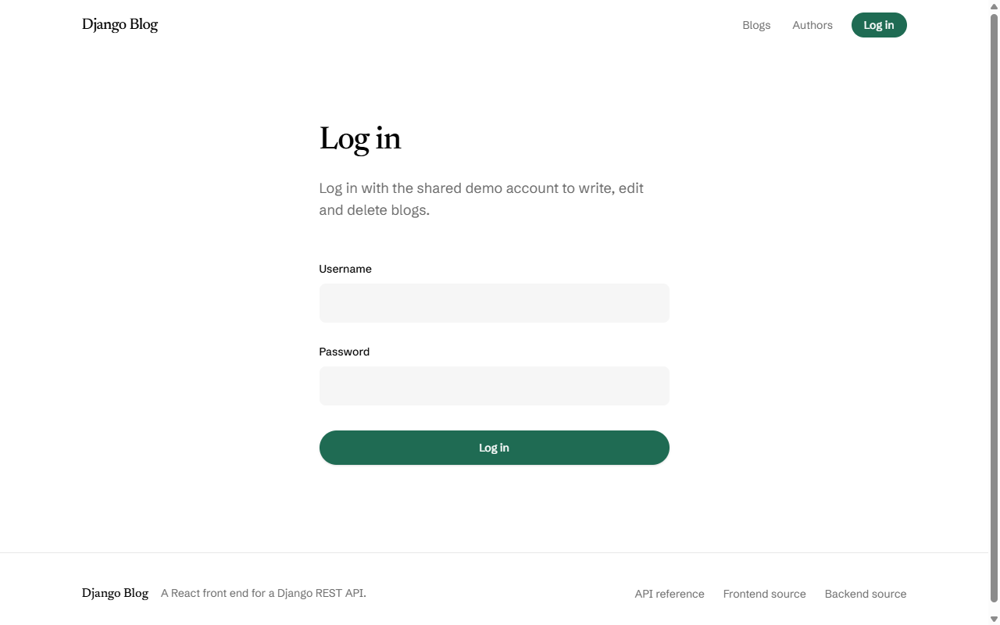
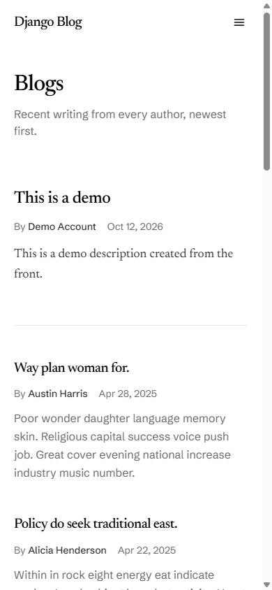
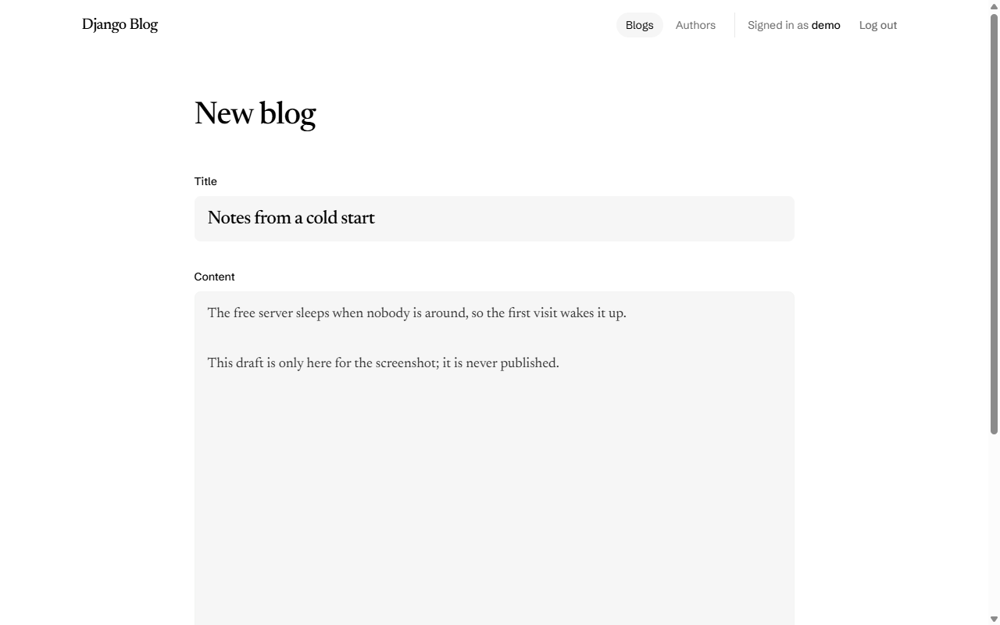
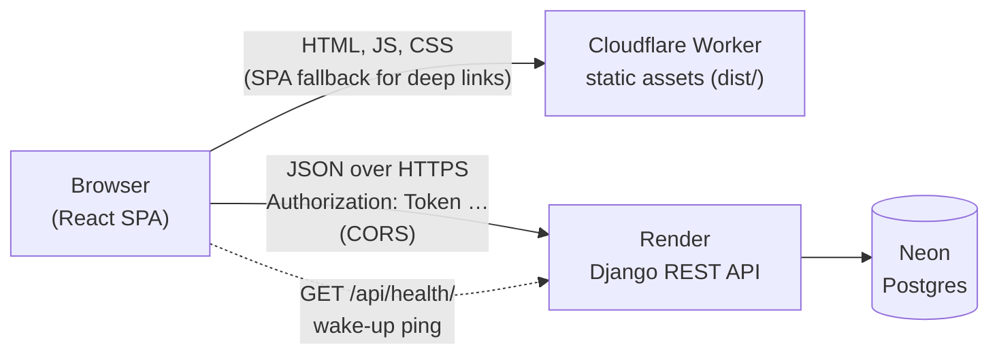

# Django Blog — React frontend

A React single-page app for the [`pirrozani/django-api`](https://github.com/pirrozani/django-api) backend, a Django 5 + Django REST Framework API for authors and blogs. Anyone can browse blogs and authors without an account. Logging in with the shared demo account unlocks creating, editing and deleting blogs. The project is a lean, portfolio-sized demo: a real UI on top of a real API, hosted end to end on free tiers.

**Live demo:** [django-blog-frontend.pirrozani.workers.dev](https://django-blog-frontend.pirrozani.workers.dev)

> The API runs on Render's free tier, which sleeps when idle. The first request can take about a minute. A banner tells you when the server is waking up.
>
> Reading is public. Writing needs the demo account, whose credentials are **not published** in this repo or the app.

## Contents

- [Screenshots](#screenshots)
- [Features](#features)
- [Tech stack](#tech-stack)
- [Architecture](#architecture)
- [Project structure](#project-structure)
- [Routes](#routes)
- [API integration](#api-integration)
- [Authentication](#authentication)
- [Token storage trade-off](#token-storage-trade-off)
- [Getting started](#getting-started)
- [Scripts](#scripts)
- [Environment variables](#environment-variables)
- [Testing](#testing)
- [Deployment](#deployment)
- [Development workflow](#development-workflow)
- [Claude Code tooling](#claude-code-tooling)
- [Related docs](#related-docs)
- [Author and license](#author-and-license)

## Screenshots

| Blog list                                                                      | Blog detail                                                                        |
| ------------------------------------------------------------------------------ | ---------------------------------------------------------------------------------- |
|  |            |
| **Authors**                                                                    | **Author profile**                                                                 |
|                             |  |
| **Log in**                                                                     | **Phone**                                                                          |
|                                    |                |
| **New blog**                                                                   |                                                                                    |
|                      |                                                                                    |

Screenshots show seeded fake data only. They were captured with `/ui-smoke --screenshots` (see [Claude Code tooling](#claude-code-tooling)).

## Features

- **Blogs:** paginated list (10 per page, newest first) and a detail page with a link to the author.
- **Authors:** paginated list and a profile page with that author's blogs, paginated.
- **Token login and logout** with the shared demo account. Visitors return to the page they came from after logging in.
- **Create, edit and delete blogs:** validated forms (React Hook Form + Zod), partial updates (`PATCH` sends only the changed fields), delete behind a confirm dialog.
- **Ownership-aware UI:** edit and delete appear only on the account's own blogs, or on every blog for staff. "New blog" appears only when the account has an author profile.
- **Protected routes:** `/blogs/new` and `/blogs/:id/edit` redirect to `/login` when logged out.
- **Auto-logout on 401:** if the shared token is revoked (another visitor logged out), the app clears the session and sends you to log in again.
- **Every page handles loading, empty and error states**, with a retry on errors, a 404 page and a route error boundary.
- **Wake-up banner:** pings `/api/health/` on load and explains the free-tier cold start. It offers a retry if the ping fails or takes longer than 90 seconds.
- **Responsive editorial design** with a mobile menu.

## Tech stack

| Concern      | Choice                                                                                       |
| ------------ | -------------------------------------------------------------------------------------------- |
| Runtime      | Node 24 (`.nvmrc`), npm with a committed `package-lock.json`                                 |
| Build        | Vite 8 + React 19 + TypeScript 6 (`strict`)                                                  |
| Routing      | React Router 7 (library mode, `createBrowserRouter`)                                         |
| Server state | TanStack Query 5                                                                             |
| HTTP         | `src/api/client.ts`: a thin `fetch` wrapper (base URL, token header, JSON, typed `ApiError`) |
| API types    | `openapi-typescript` → `src/api/schema.d.ts` (generated, never hand-edited)                  |
| Forms        | React Hook Form 7 + Zod 4                                                                    |
| Styling      | Tailwind CSS 4 (`@tailwindcss/vite`)                                                         |
| Tests        | Vitest 5 + React Testing Library + MSW 2                                                     |
| Quality      | ESLint 10 (flat config) + Prettier + `tsc --noEmit`                                          |
| Hosting      | Cloudflare Workers static assets (`wrangler.jsonc`, Workers Builds from `main`)              |

There's no global state library, CSS-in-JS or UI kit. The MVP deliberately keeps its dependencies to the table above.

## Architecture



- The Worker only serves the built files. There's no server code: `not_found_handling: "single-page-application"` returns `index.html` for unknown paths, so deep links like `/blogs/42` work on refresh.
- The browser calls the API directly, cross-origin. There is no proxy, locally or in production, so CORS problems show up in development too.
- **Request flow:** page component → feature hook (`features/*/queries.ts`, TanStack Query) → endpoint function (`api/blogs.ts`, `api/users.ts`, `api/auth.ts`) → `apiFetch` in `api/client.ts` → API. Responses come back typed from the generated schema. Failures come back as `ApiError`.

## Project structure

```
src/
├─ api/                  # Every server call goes through here
│  ├─ client.ts          # apiFetch: base URL, token header, JSON, ApiError, 401 hook
│  ├─ pagination.ts      # toPage(): normalizes paginated or plain-array lists
│  ├─ auth.ts            # login, logout, me, health
│  ├─ blogs.ts           # list/get/create/update/delete blogs
│  ├─ users.ts           # list/get authors, an author's blogs
│  ├─ types.ts           # Friendly aliases over the generated schema
│  └─ schema.d.ts        # Generated by `npm run gen:api` (do not edit)
├─ auth/                 # AuthProvider, AuthContext/useAuth, RequireAuth, LoginPage, tokenStorage
├─ components/           # Layout, Navbar, Footer, Pagination, Spinner, EmptyState, ErrorState,
│                        # ConfirmDialog, WakeUpBanner, NotFoundPage, RouteErrorPage, Button…
├─ features/
│  ├─ blogs/             # List, detail and form pages, query hooks, Zod schema, permissions
│  └─ users/             # Author list and profile pages, query hooks
├─ mocks/                # MSW handlers and fixtures for tests
├─ test/                 # Vitest setup and a renderRoute() helper
├─ config.ts             # API_URL (the only place that reads import.meta.env)
├─ queryClient.ts        # QueryClient defaults (retry policy)
├─ routeParams.ts        # Parsing of :id and ?page= params
├─ routes.tsx            # The route table
└─ main.tsx              # Entry point
scripts/gen-api.mjs      # Generates src/api/schema.d.ts from the backend's OpenAPI schema
docs/                    # Scope, architecture, API contract, plan, configuration, screenshots
wrangler.jsonc           # Cloudflare Workers static-assets config
```

## Routes

| Path              | Page                                                 | Login    |
| ----------------- | ---------------------------------------------------- | -------- |
| `/`               | Redirects to `/blogs`                                | —        |
| `/blogs`          | Blog list (`?page=N`)                                | —        |
| `/blogs/:id`      | Blog detail, with edit/delete for the owner or staff | —        |
| `/blogs/new`      | Create a blog                                        | required |
| `/blogs/:id/edit` | Edit a blog                                          | required |
| `/users`          | Author list (`?page=N`)                              | —        |
| `/users/:id`      | Author profile with that author's blogs              | —        |
| `/login`          | Log in                                               | —        |
| `*`               | 404 page                                             | —        |

Routes keep the API's naming (`/users`), but the UI calls them **Authors** (see [Authentication](#authentication)).

## API integration

The backend owns the API. The exact contract is in [`docs/03-api-contract.md`](docs/03-api-contract.md) and, for field types, in the live OpenAPI schema at `<API>/api/schema/` (Swagger UI at `<API>/api/schema/swagger-ui/`).

- **Client:** `apiFetch` prefixes `API_URL`, sends JSON, adds `Authorization: Token <token>` when logged in, and never sends cookies. Every path keeps its **trailing slash** (`/api/blogs/`).
- **Errors:** every failure becomes an `ApiError` with `status` (`0` when the server couldn't be reached), `detail`, `nonFieldErrors` and `fieldErrors`, mapped from DRF's `{"detail": …}`, `{"non_field_errors": […]}` and `{"field": […]}` bodies. Forms show field errors next to their inputs.
- **Pagination:** lists come back as `{count, next, previous, results}` (10 per page). `toPage()` in `src/api/pagination.ts` turns that, or a plain array, into one page for the `Pagination` component.
- **Types:** `src/api/schema.d.ts` is generated from the backend schema with `npm run gen:api`. Regenerate it when the backend changes and never edit it by hand. `src/api/types.ts` exposes the handful of types the app uses.
- **Caching:** each feature has one query-key factory (`blogKeys`, `userKeys`). Mutations update the detail cache with the server response and invalidate the lists they affect, including the author's blog list. 4xx errors are never retried. 5xx and network errors are retried twice.

## Authentication

There are **two kinds of "user"** in the backend:

- **Login accounts** are Django `auth.User` records, like the demo account. They're used only to get a token.
- **Authors** (`/api/users/`) are content: the people blogs belong to. The UI calls them Authors. A login account can be linked to one author profile.

The flow:

1. `POST /api/auth/token/` with `{username, password}` returns `{"token": "…"}`. Wrong credentials return **400** with `non_field_errors`. More than 20 attempts per minute per IP return **429**. The form shows both.
2. The token is stored (see below), and `GET /api/auth/me/` returns `{id, username, is_staff, author_id}`. That call also runs on every page load when a token is already stored.
3. `RequireAuth` guards the write routes and remembers where the visitor was going.
4. A new blog belongs to the account's author profile. The API returns 403 when the account has none, so the UI hides "New blog" in that case. Only the owner or staff can edit or delete a blog. The UI compares `author_id` with `blog.user`, and the API enforces the same rule.
5. `POST /api/auth/logout/` revokes the token **for every session on the account**. The demo account is shared, so one visitor logging out logs everyone out. Any request that gets a 401 with a token clears the session and sends an active user back to `/login`.

## Token storage trade-off

The token is kept in `localStorage` (`src/auth/tokenStorage.ts`) for simplicity, which is fine for a demo. Any XSS on the page could read it. The mitigations:

- React escapes everything it renders by default.
- The app never uses `dangerouslySetInnerHTML`. Blog content is plain text rendered with `whitespace-pre-wrap`.
- Tokens are revocable: logout deletes the token on the server.

HttpOnly cookies would be safer, but they don't work reliably cross-site (`workers.dev` ↔ `onrender.com`) without a shared custom domain. See the backend's roadmap in [`docs/`](https://github.com/pirrozani/django-api/tree/develop/docs). Logging in needs `localStorage`: if storage is blocked (some private modes), the app treats it as "no token" and the login fails, while browsing still works.

## Getting started

**Prerequisites:** Node 24 (`nvm use` reads `.nvmrc`), npm, and a local copy of the [backend](https://github.com/pirrozani/django-api) with its own setup done (it uses `uv`).

```bash
# 1. Install dependencies from the lockfile
npm ci

# 2. Point the app at the backend: copy the template to .env.local
cp .env.example .env.local      # VITE_API_URL=http://127.0.0.1:8000

# 3. Start the backend (in its own repo/terminal)
cd ../django-api && uv run python manage.py runserver   # http://127.0.0.1:8000

# 4. Start the frontend
npm run dev                      # http://localhost:5173
```

- The backend's local CORS settings already allow `http://localhost:5173`.
- There's deliberately **no Vite proxy**. The app talks to the API cross-origin, as in production.
- In dev, `VITE_API_URL` falls back to `http://127.0.0.1:8000` if it's unset. A production build without it fails on purpose.
- To try the write flows locally, create a demo account in the backend (`create_demo_user`, see its `docs/06-configuration.md`).

## Scripts

| Command                         | What it does                                                                                                                                                                                                                              |
| ------------------------------- | ----------------------------------------------------------------------------------------------------------------------------------------------------------------------------------------------------------------------------------------- |
| `npm run dev`                   | Vite dev server on http://localhost:5173                                                                                                                                                                                                  |
| `npm run build`                 | Type-checks the project (`tsc -b`) and builds to `dist/`. Fails if `VITE_API_URL` is unset.                                                                                                                                               |
| `npm run preview`               | Serves the built `dist/` locally                                                                                                                                                                                                          |
| `npm run lint`                  | ESLint (flat config)                                                                                                                                                                                                                      |
| `npm run typecheck`             | `tsc --noEmit` on the app sources                                                                                                                                                                                                         |
| `npm test`                      | Vitest, run once                                                                                                                                                                                                                          |
| `npm run format`                | Prettier, writes changes                                                                                                                                                                                                                  |
| `npm run gen:api`               | Regenerates `src/api/schema.d.ts` from `$VITE_API_URL/api/schema/` (or the local backend at `http://127.0.0.1:8000` when unset). Also accepts an origin (`npm run gen:api -- https://api.example`) or a schema file (`-- ./schema.json`). |
| `npx wrangler deploy --dry-run` | Validates `wrangler.jsonc` and `dist/` without uploading                                                                                                                                                                                  |

## Environment variables

There is exactly **one** variable:

| Variable       | Example                          | Purpose                           |
| -------------- | -------------------------------- | --------------------------------- |
| `VITE_API_URL` | `https://<backend>.onrender.com` | Backend origin, no trailing slash |

- It is **not a secret**. Vite inlines it into the public JavaScript bundle at build time, so anyone can read it. Never put a secret in a `VITE_*` variable.
- **Local:** `.env.local` (gitignored), copied from the committed template `.env.example`.
- **Production:** Cloudflare dashboard → Workers & Pages → the worker → Settings → **Build → Variables and secrets** (a _build_ variable). Not GitHub secrets (Workers Builds builds on Cloudflare, not in GitHub Actions), and not `vars` in `wrangler.jsonc` (those are runtime variables for Worker code and never reach the Vite build).
- Changing it only takes effect after a **rebuild**: retry the build in Cloudflare or push to `main`.

## Testing

Tests use **Vitest** in jsdom with **React Testing Library**. **MSW** (`src/mocks/`) intercepts `fetch` at the network level, so tests exercise the real API client. `src/test/renderRoute.tsx` renders a route inside the real router, query client and auth provider.

What's covered:

- `ApiError` mapping and `apiFetch` behaviour (`src/api/client.test.ts`)
- The pagination normalizer (`src/api/pagination.test.ts`)
- The retry policy (`src/queryClient.test.ts`)
- The login flow, error messages, logout, `RequireAuth` redirects and auto-logout on 401 (`src/auth/auth.test.tsx`)
- Blog list and detail, the create/edit form, delete with confirm and permissions (`src/features/blogs/*.test.tsx`)
- Author list and profile (`src/features/users/users.test.tsx`)
- The route table and 404 page (`src/routes.test.tsx`), Navbar, ConfirmDialog and WakeUpBanner

```bash
npm test                 # run once
npx vitest               # watch mode
```

## Deployment

- **Hosting:** Cloudflare Workers **static assets**. `wrangler.jsonc` serves `./dist` with the single-page-application fallback.
- **Builds:** Cloudflare **Workers Builds** is connected to this repo and builds and deploys every push to `main` (`npm run build`). `develop` and feature branches don't deploy.
- **Config:** `VITE_API_URL` is set as a build variable (see [Environment variables](#environment-variables)). A build without it fails with a message saying where to set it.
- **CORS:** the backend must list the Worker's exact origin (`https://…workers.dev`, no trailing slash) in `CORS_ALLOWED_ORIGINS` on Render.
- **Checks:** `npx wrangler deploy --dry-run` validates the config and build locally. `/deploy-check` also checks health, CORS, deep links and that the bundle points at the right API.
- **Backend:** Render (Django, free tier, sleeps when idle) with Neon Postgres. A `reset_demo` command restores the demo data.

## Development workflow

- **Work items** are [GitHub issues](https://github.com/pirrozani/django-blog-frontend/issues). They're written from the fix template (`.github/ISSUE_TEMPLATE/fix.md`: Problem / Evidence / Impact / Fix / Acceptance criteria / Notes) and labelled `priority: P0`–`P3`:
  - P0: the app doesn't build or run
  - P1: blocks the demo or a deploy, or is a security problem
  - P2: a page or UX the demo needs
  - P3: polish
- **Branches:**
  - Work happens on `feature/<N>-<slug>`, branched from `develop`.
  - PRs go `feature/*` → `develop` and are **squash-merged**. The squash message carries `Closes #N`.
  - `develop` → `main` is a release, merged with a **merge commit**. Issues close when the release lands on `main`.
  - Nothing is committed directly to `main`.
- **Commits:** `feat`, `fix`, `refactor`, `chore`, `docs` and `test` prefixes.
- **Releases:**
  - Semantic versions in `package.json`, tagged (`0.1.0`, `0.2.0`, …), each with a GitHub release.
  - After a release, `main` is merged back into `develop`.
- **Before a PR:** `npm run lint`, `npm run typecheck`, `npm test` and `npm run build` all pass.
- **Backend problems** become issues on [`pirrozani/django-api`](https://github.com/pirrozani/django-api/issues). The frontend doesn't silently work around them.

## Claude Code tooling

This repo is set up for [Claude Code](https://claude.com/claude-code). Project rules live in [`CLAUDE.md`](CLAUDE.md), and the helpers live in `.claude/`.

| Helper                           | Purpose                                                                                                                           |
| -------------------------------- | --------------------------------------------------------------------------------------------------------------------------------- |
| `/issue`                         | Investigate a problem and draft a GitHub issue from the fix template                                                              |
| `/resolve-issue <N>`             | Implement issue #N on its feature branch and verify its acceptance criteria                                                       |
| `/pr`                            | Health check, then open a PR to `develop` with `Closes #N`                                                                        |
| `/review-pr [N]`                 | Review a PR against its issue and the repo rules                                                                                  |
| `/release`                       | Ship `develop` → `main`: version bump, release PR, tag, GitHub release, back-merge                                                |
| `/health-check`                  | Lint, typecheck, tests, build and a secret scan in one read-only pass                                                             |
| `/api-sync`                      | Regenerate API types from the backend schema and report drift                                                                     |
| `/deploy-check`                  | Validate `wrangler.jsonc` and the build, plus live CORS, deep-link and env checks                                                 |
| `/ui-smoke`                      | Drive the running app in a browser (Playwright) through the demo flows, with screenshots                                          |
| `ui-reviewer` agent              | React/TypeScript review of a branch diff                                                                                          |
| `backend-contract` agent         | Read-only answers about the backend's endpoints, and drafts of backend issues                                                     |
| Hooks (`.claude/hooks/guard.py`) | Block reading env files, editing `node_modules/`, `dist/` or the generated schema, and real `wrangler deploy` / `wrangler secret` |
| Zod MCP (`.mcp.json`)            | Zod v4 documentation lookups                                                                                                      |

## Related docs

- [`docs/README.md`](docs/README.md): MVP scope, issue order and how this repo stays in sync with the backend
- [`docs/01-architecture.md`](docs/01-architecture.md): target architecture, decision log, free-tier constraints
- [`docs/03-api-contract.md`](docs/03-api-contract.md): endpoints, auth and JSON shapes
- [`docs/05-frontend-plan.md`](docs/05-frontend-plan.md): the full frontend plan
- [`docs/06-configuration.md`](docs/06-configuration.md): environment variables for both apps, local setup
- Backend docs: [`pirrozani/django-api/docs`](https://github.com/pirrozani/django-api/tree/develop/docs)

## Author and license

Built by [@pirrozani](https://github.com/pirrozani) as a portfolio project. No license has been chosen yet, so all rights are reserved.
